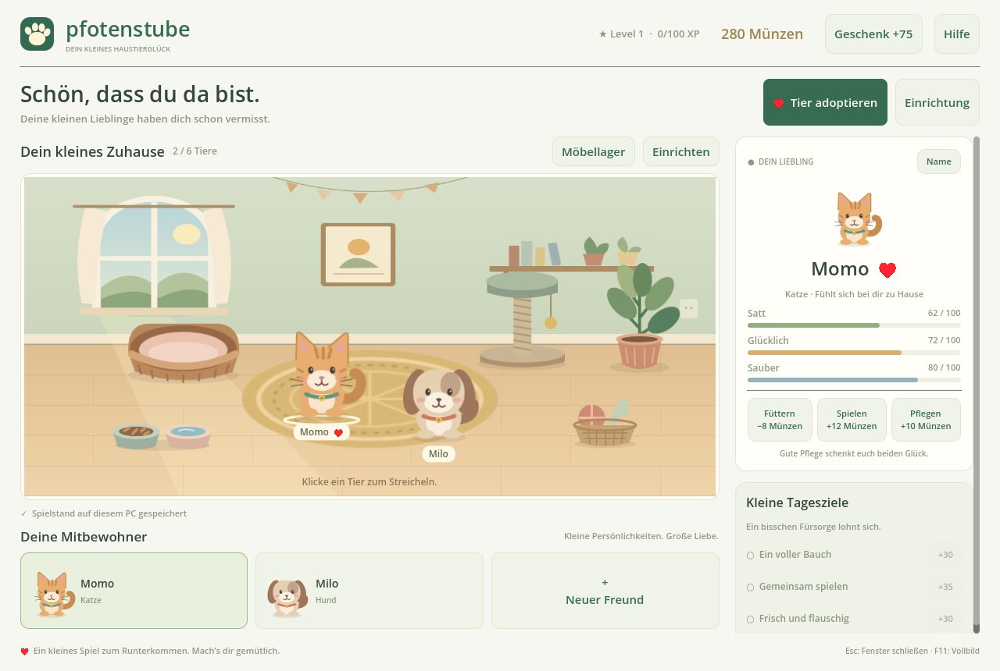

# Pfotenstube

Ein gemütliches 2D-Haustierspiel, inspiriert vom damaligen Happy Pets. **Die aktuelle Entwicklung verwendet Godot 4.6.3 und GDScript.** Der frühere React-Prototyp bleibt als Gestaltungsvorlage erhalten.

## Auf deinem Windows-PC testen

1. [Pfotenstube-Windows-x64.zip](exports/Pfotenstube-Windows-x64.zip) herunterladen.
2. Rechtsklick auf das ZIP → **Alle extrahieren**.
3. Im entpackten Ordner **Pfotenstube.exe** doppelklicken.

Du brauchst keinen Godot-Editor, kein Node.js und kein Konto. Enthalten sind Pflege, Streicheln, Adoption, Münzen, Level, Tagesziele, Möbel und lokale Spielstände. Der Windows-Export ist erstellt; ein tatsächlicher Windows-Lauf wurde in dieser Linux-Cloud nicht geprüft.

## Mit Godot weiterarbeiten

Im Godot-Projektmanager [godot/project.godot](godot/project.godot) importieren und **F5** drücken. Alternativ das [Godot-Projektpaket](exports/Pfotenstube-Godot-Projekt.zip) entpacken und darin `project.godot` importieren.

Die [Godot-Anleitung](godot/README.md) beschreibt Bedienung, Speicherort und Prüfungen. Die Cloud-Einrichtung wird mit `bash tools/setup-godot.sh` wiederholt; daraus entstehen auch die beiden ZIP-Pakete unter `exports/`.

Das Spiel ist ein erster Prototyp. Zucht, Freundesbesuche, Konten und Mehrspielerfunktionen sind noch nicht enthalten. Grafiken und Name sind eigenständig; eine Facebook-Verbindung gibt es nicht.

## Früherer Browser-Prototyp

`src/`, `public/`, `tests/` sowie die npm-/Vite-Konfiguration gehören zur früheren Browser-Version. Sie werden für die Godot-Version nicht benötigt. Ihre Anleitung steht unter [docs/WEB-PROTOTYP.md](docs/WEB-PROTOTYP.md). Ihre Spielstände sind nicht mit dem Godot-Format kompatibel.
