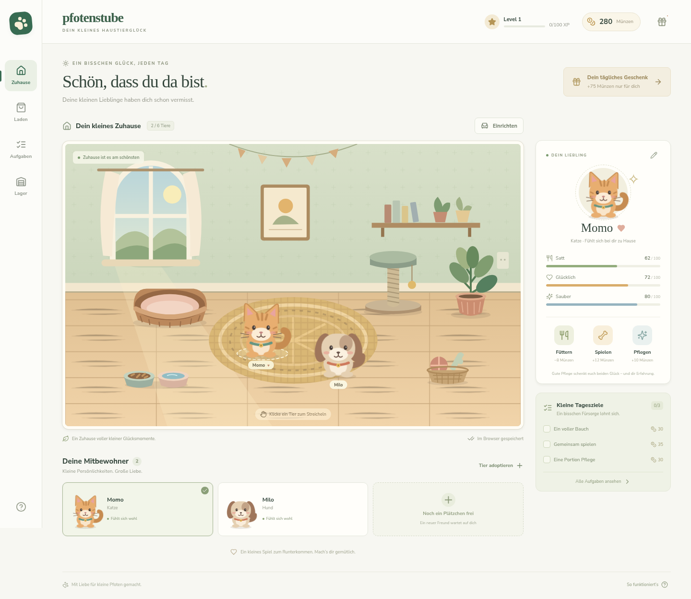

# Pfotenstube

Ein gemütliches 2D-Haustierspiel für den Browser, inspiriert vom Spielprinzip klassischer Social-Pet-Games wie Happy Pets. Eigenständige SVG-Grafiken, deutsche Oberfläche, keine Facebook-Anbindung und keine Käufe mit echtem Geld.



## Spielen

- Zwei Mitbewohner begrüßen dich: Momo die Katze und Milo der Hund.
- Wähle ein Tier aus und füttere es, spiele mit ihm oder pflege es. Ein Klick auf das Tier im Zimmer streichelt es.
- Futter kostet 8 Münzen. Spielen bringt 12 und Pflegen 10 Münzen. Bereits gut versorgte Tiere geben keine weiteren Aktionsbelohnungen.
- Hole dir einmal pro Kalendertag 75 Münzen und erledige drei Tagesaufgaben. Je 100 XP steigt dein Level; ab Level 2 können Kaninchen einziehen.
- Im Laden warten weitere Tiere und acht Einrichtungsgegenstände. Bis zu sechs Tiere und 40 Möbel gehören zu einer Stube.
- Möbel im Einrichtungsmodus ziehen oder per Pfeiltasten verschieben, drehen und ins Lager stellen. Eingelagerte Möbel kannst du kostenlos wieder aufstellen.
- Über das Stiftsymbol kannst du Tiere umbenennen.

Die Bedürfnisse sinken langsam mit der Zeit. Bei längeren Pausen werden höchstens acht Stunden berücksichtigt. Tiere sterben nicht.

## Entwicklung

Voraussetzung: **Node.js 22.12+**, getestet mit Node.js 24 und npm 11. Keine Datenbank, Zugangsdaten oder Umgebungsvariablen erforderlich. Schrift und Grafiken werden lokal ausgeliefert.

```bash
cd /workspace/happypets-remake.
npm ci
npm run dev
```

Der Entwicklungsserver bindet Port **5173**. Er muss nach dem Start einer neuen Cloud-Maschine erneut gestartet werden. Bestehenden Checkout verwenden; für normale Cloud-Aufgaben keinen zusätzlichen Git-Worktree anlegen.

```bash
npm run build       # TypeScript-Prüfung und Produktionsbuild nach dist/
npm test            # Tests der Spiellogik
npm run check       # TypeScript einzeln prüfen
npm run preview     # Produktionsbuild auf Port 4173 starten
```

Browserprüfungen mit vorhandenem Chromium:

```bash
PLAYWRIGHT_CHROMIUM_EXECUTABLE_PATH=/usr/bin/chromium npm run test:e2e
```

Auf Rechnern ohne System-Chromium zuerst `npx playwright install chromium` ausführen, dann `npm run test:e2e`. Die Tests starten bei Bedarf selbst den Entwicklungsserver. Sie prüfen Spielaktionen, Belohnungen, Adoption, Einrichtung, Speicherung und Fehlerbehandlung auf Desktop und Mobilgerät.

## Spielstand

Fortschritt liegt unter `pfotenstube.save.v1` im lokalen Browserspeicher. Er ist an **Browser und Website-Adresse** gebunden. Das Löschen der Website-Daten entfernt den Spielstand. Unter **Hilfe & Spielstand** kannst du eine JSON-Sicherung exportieren und importieren. Ein Import ersetzt nach Bestätigung den aktuellen Fortschritt; zuvor wird eine lokale Sicherung unter `pfotenstube.save.v1.backup` abgelegt, sofern der Browserspeicher verfügbar ist.

Ungültige Spielstände werden geprüft und, wenn möglich, vor einem Neustart gesichert. Falls Speicherung blockiert ist, zeigt das Spiel einen Hinweis. Ohne Browserspeicher bleibt der Fortschritt nur für die aktuelle Sitzung erhalten.

## Aufbau und Grenzen

- `src/game.ts`: unabhängige Spiellogik, Kataloge und Spielstandprüfung.
- `src/App.tsx`: Oberfläche, Aktionen und lokale Speicherung.
- `src/components/Room.tsx`: animiertes 2D-Zimmer und Möbeleinrichtung.
- `src/components/Art.tsx`: eigene Tier-, Möbel- und Zimmergrafiken.
- `src/game.test.ts`, `tests/game.spec.ts`: Logik- und Browserprüfungen.

Diese erste spielbare Version umfasst Pflege, Fortschritt, Adoption und Einrichtung. Konten, gemeinsamer Server-Spielstand, Freunde, Zucht und Mehrspielerfunktionen sind noch nicht umgesetzt. Münzen sind eine lokale Spielressource und nicht für echte Transaktionen gedacht. Änderungen in mehreren gleichzeitig geöffneten Tabs werden nicht zusammengeführt.
